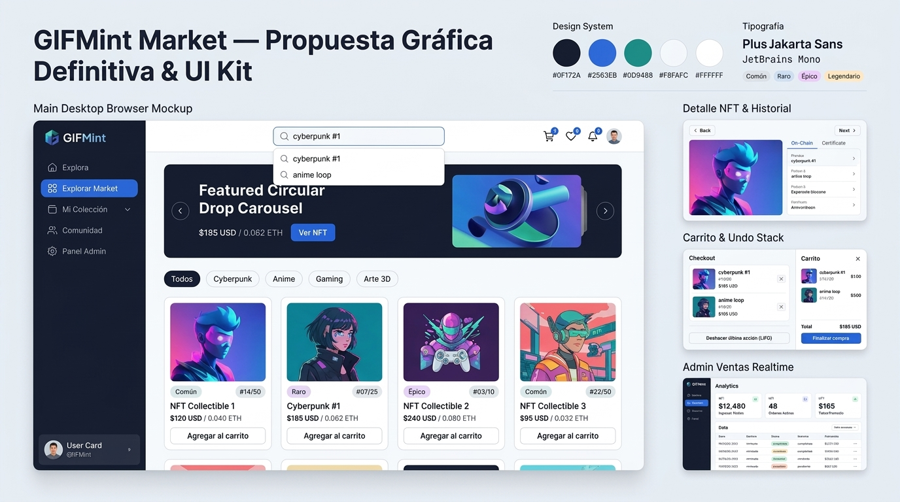

# GIFMint Market — E-Commerce de Coleccionables GIF-NFT

Plataforma web **E-Commerce de Coleccionables GIF-NFT** construida con **Angular 21**, **TypeScript**, **SASS**, **Bootstrap 5**, **Axios**, **Supabase** (Auth, PostgreSQL, RLS, Realtime, Storage) y la **API de GIPHY** en tiempo real.

Cada GIF obtenido desde GIPHY es enriquecido determinísticamente con atributos de coleccionable digital (`precio` en USD y ETH simbólico, `rareza`, `edición`, `categoría`, `popularidad` y `tokenHash`), permitiendo navegar, buscar con autocompletado inteligente, gestionar favoritos y carrito, procesar órdenes de minteo y operar un panel administrativo en tiempo real.

---

## Integrantes

- **Julian Andres Zapata Posada** — Código: **2240291**
- **Yeick Jacson Moreno Ruiz** — Código: **2240991**

---

## Metodología de Trabajo Colaborativo (VS Code Live Share)

Los dos integrantes (**Julian Andres Zapata Posada — 2240291** y **Yeick Jacson Moreno Ruiz — 2240991**) desarrollaron el proyecto de forma simultánea y colaborativa en tiempo real utilizando la extensión **Live Share de Visual Studio Code** sobre el mismo entorno de trabajo.

Por este motivo, todo el desarrollo, pruebas y correcciones se consolidaron directamente en la rama principal (`main`) desde la sesión compartida, en lugar de mantener ramas separadas por integrante.

---

## Enlaces del Proyecto

- **Propuesta Gráfica Definitiva:** [docs/propuesta-grafica.png](./docs/propuesta-grafica.png)
- **Aplicación Publicada en Vercel:** [https://gifmint-nft-marketplace.vercel.app](https://gifmint-nft-marketplace.vercel.app)



---

## Estructuras de Datos Implementadas

| Estructura | Archivo | Uso Principal en la Plataforma |
|---|---|---|
| `LinkedList` | `src/app/data-structures/linked-list.ts` | Carrito de compras aislado por usuario (`/carrito`) |
| `DoublyLinkedList` | `src/app/data-structures/doubly-linked-list.ts` | Historial Atrás / Siguiente de GIF-NFTs visitados (`/nft/:id`) |
| `CircularLinkedList` | `src/app/data-structures/circular-linked-list.ts` | Carrusel infinito de drops destacados en Home (`/`) |
| `Stack` (LIFO) | `src/app/data-structures/stack.ts` | Botón "Deshacer último cambio" en Carrito (`/carrito`) |
| `Queue` (FIFO) | `src/app/data-structures/queue.ts` | Cola de procesamiento de órdenes por llegada (`/mis-ordenes`) |
| `BinaryTree` (BST) | `src/app/data-structures/binary-tree.ts` | Ordenamiento interno por precio (`inOrderItems()`) desde "Ordenar por" en Catálogo (`/catalogo`) |
| `NaryTree` | `src/app/data-structures/nary-tree.ts` | Sidebar jerárquico multinivel (con submenú Categorías) y categorías en Home |
| `Graph` | `src/app/data-structures/graph.ts` | Red interna de afinidad para "Productos Relacionados" en detalle (`/nft/:id`) |
| `Trie` | `src/app/data-structures/trie.ts` | Autocompletado instantáneo por prefijo en la barra de búsqueda superior |
| `MinHeap` | `src/app/data-structures/min-heap.ts` | Ranking Top-K más populares en Home y autocompletado ordenado |

---

## Credenciales de Acceso Admin

Para entrar a el panel de administración (`/admin/ventas` y `/admin/usuarios` en el menú **Administración** del sidebar), inicia sesión en `/login` con:

- **Correo:** `admin@gifmint.com`
- **Contraseña:** `GifMintAdmin2026!`

*(Cualquier cuenta nueva creada desde `/registro` ingresa automáticamente con rol `cliente`).*

---

## Ejecución Local

```bash
npm install
ng serve
```

Abre `http://localhost:4200/` en tu navegador.

---

## Despliegue en Vercel

El proyecto incluye [`vercel.json`](./vercel.json) para soporte SPA de Angular Router:

- **Framework Preset:** `Angular`
- **Build Command:** `npm run build`
- **Output Directory:** `dist/Proyecto-Final/browser`
- **Producción:** [https://gifmint-nft-marketplace.vercel.app](https://gifmint-nft-marketplace.vercel.app)

